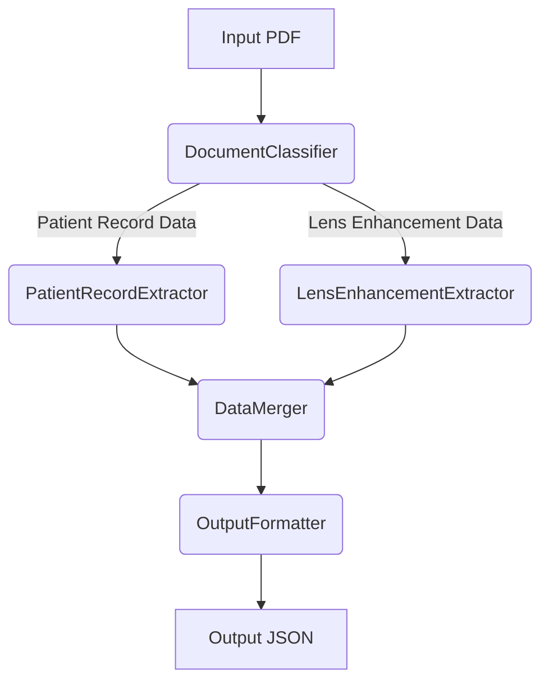

# VSP Vision Benefits Extractor - Design Plan

## 1. Introduction & Goals

The primary goal of the VSP Vision Benefits Extractor module is to process VSP Patient Record and VSP Lens Enhancement PDF documents to generate a standardized JSON output. This output will contain comprehensive vision benefit information, including patient details (redacted), eligibility, plan specifics (copays, allowances), and accurate lens option pricing, derived by combining data from both document types. This module leverages VSP's code-based system for lens enhancements as detailed in `vsp-code-mapping.py` and the overall process outlined in `vsp-extractor-workflow.md`.

## 2. Input Data Analysis

The module must handle the following input PDF types found in `tests/samples/VSP/`:

*   **VSP Patient Record Report:**
    *   Examples: `vsp1.pdf` (Combined), `vsp3.pdf` (Elements Plan), `vspsavings.pdf` (Savings Pass Plan).
    *   Contains: Patient ID/Name, Member Name, Auth#, Eligibility flags (Exam, Lens, Frame, Contacts), Plan Name, Network, Copays, Frame Allowance details, Contact Lens benefits/allowances.
    *   Key for identifying truly "Covered" ($0 cost) items and base plan details.
    *   Variations exist based on plan type (e.g., "Elements Plan", "Savings Pass").
*   **VSP Lens Enhancement Charges:**
    *   Examples: `vsp2.pdf`, `vsp22.pdf`, `vsp33.pdf`.
    *   Contains: Detailed pricing (Single/Multi Cost) for lens options mapped by codes (e.g., AA, KA, QM).
    *   Structure: Hierarchical categories (LENSES, TINTS, COATINGS, MISCELLANEOUS) and subcategories.
    *   Pricing Strategies: Explicit dollar amounts, "Covered" (often $0), "Covered With Additional Copay", "Covered With Additional Copay, 80% of U&C", "Covered With Additional Copay, 80% of U&C to Max". Section-level strategies might apply when individual prices are missing (e.g., `vsp33.pdf` High Index section).
*   **Combined Documents:**
    *   Example: `vsp1.pdf` contains both Patient Record and Lens Enhancement sections within the same file. The extractor needs to handle parsing both sections from such files.

## 3. Core Components & Architecture

Based on `vsp-extractor-integration-demo.py` and `vsp-extractor-sample.py`, the following components are proposed:

*   **`DocumentClassifier`:**
    *   Input: PDF file path.
    *   Responsibility: Analyze PDF content (e.g., headers like "VSP PATIENT RECORD REPORT", "VSP Lens Enhancement Charges") to determine the document type(s) present (PatientRecord, LensEnhancement, Combined, Unknown).
    *   Output: Document type classification.
*   **`PatientRecordExtractor`:**
    *   Input: PDF file path identified as containing Patient Record data.
    *   Responsibility: Extract patient info (redacted), eligibility flags, plan name, network, copays, frame allowance, contact lens benefits. Identify items explicitly marked as "Covered" or having $0 copay.
    *   Output: Dictionary containing structured Patient Record data.
*   **`LensEnhancementExtractor`:**
    *   Input: PDF file path identified as containing Lens Enhancement data.
    *   Responsibility: Parse the hierarchical lens structure using `vsp-code-mapping.py`. Extract Single/Multi costs for each lens code (AA, KA, etc.). Interpret and apply section-level pricing strategies ("Covered", "% U&C", etc.) where individual prices are missing or specified at the section level.
    *   Output: Dictionary containing structured Lens Enhancement pricing data, mirroring the hierarchy in `vsp-code-mapping.py`.
*   **`DataMerger`:**
    *   Input: Structured data from `PatientRecordExtractor` and `LensEnhancementExtractor`.
    *   Responsibility: Combine the data into the final target JSON structure. Crucially, override lens pricing from the Lens Enhancement data with $0 cost if the Patient Record indicates the item is fully "Covered". Ensure consistency (e.g., patient ID).
    *   Output: A single dictionary representing the combined, validated benefit information.
*   **`OutputFormatter`:**
    *   Input: The merged data dictionary.
    *   Responsibility: Ensure the final dictionary strictly adheres to the target JSON schema defined in `vsp output structure.txt` and `vsp-extractor-workflow.md`. Add metadata like processing date.
    *   Output: Final JSON-compatible dictionary.

*(Optional Mermaid Diagram can be added here later if desired)*

## 4. Detailed Extraction Logic

Based on the workflow document, sample code, and PDFs:

*   **Patient Information:**
    *   Extract `Auth#` (e.g., 76863196 from `vsp1.pdf`, line 5) as `id_number`.
    *   Extract `Patient Name` (e.g., LOGAN S VIERS from `vsp1.pdf`, line 5) but store as `"[REDACTED]"` in the output.
*   **Eligibility Status:**
    *   Parse the "Eligibility" line (e.g., `vsp1.pdf`, line 20) to determine boolean flags for `exam`, `lens`, `frame`, `contact_lens_exam`, `contacts`.
*   **Plan Details:**
    *   Extract `Benefit` (e.g., "VSP Choice Plan" from `vsp1.pdf`, line 36) as `plan_name`.
    *   Extract `Exam Copay` (e.g., $20.00 from `vsp1.pdf`, line 39) and potentially other copays if listed separately (like in `vsp3.pdf`, line 45). Store numeric copay values.
    *   Extract `Frame Allowance` details (e.g., `vsp1.pdf`, lines 48-50), including base allowance, specific brand allowances (Altair/Marchon), and overage savings percentage.
    *   Extract `Contact Lens` benefits (e.g., CL Exam copay/coverage, CL Materials allowance from `vsp1.pdf`, lines 53-54).
*   **Lens Pricing (`LensEnhancementExtractor`):**
    *   Use `vsp-code-mapping.py::VSP_LENS_STRUCTURE` as the template.
    *   Iterate through categories/subcategories/options defined in the mapping.
    *   For each option (code like "AA", "KA"):
        *   Attempt to find the corresponding line in the PDF (e.g., `vsp2.pdf`, line 11: "AA - Used for Product Navigation (XAA)").
        *   Extract associated `Single Cost` and `Multi Cost` dollar values (e.g., $31, $35 from `vsp2.pdf`, line 12). Store as numbers (int or float).
        *   If explicit dollar values are missing, check for section-level pricing indicators (e.g., "Covered", "Covered With Additional Copay", "Covered With Additional Copay, 80% of U&C", "Covered With Additional Copay, 80% of U&C to Max" - see `vsp2.pdf`, lines 9-10, `vsp33.pdf`, lines 9-10, 124-127).
        *   Store these string indicators directly as the cost if no dollar value is found or if the indicator applies to the whole section.
        *   Handle variations where costs might be absent (e.g., `vsp33.pdf`, Aspheric section).
    *   Implement logic similar to `vsp-extractor-sample.py::_extract_prices_for_code` using regex, but enhance to capture the string-based pricing strategies.
*   **Data Merging (`DataMerger`):**
    *   Prioritize Patient Record data for items explicitly stated as "Covered" or having $0 copay, setting the final cost to 0 for those lens options, overriding any price found in the Lens Enhancement sheet.

## 5. Data Structures

*   **Intermediate:** Python dictionaries closely mirroring the structure of `VSP_LENS_STRUCTURE` for extracted lens data, and separate dictionaries for patient info, eligibility, and plan details.
*   **Final Output:** JSON structure as defined in `vsp output structure.txt` and `vsp-extractor-workflow.md` (section 90 onwards), ensuring fields like `document_type`, `patient_info`, `eligibility_info` (without service frequency), `plan_details`, and `lens_categories` are present and correctly populated.

## 6. Error Handling & Validation

*   **Missing Documents:** Log errors if either Patient Record or Lens Enhancement data cannot be found (relevant for combined processing or if separate files are expected).
*   **Extraction Failures:** Use `try-except` blocks during parsing. Log specific errors (e.g., failed regex match for a price). If a price cannot be determined, store `null` or the section-level pricing string.
*   **Inconsistent Data:** Flag potential inconsistencies (e.g., if Patient Record says covered but Lens Enhancement shows a price > 0, although the merge logic should handle this by prioritizing $0).
*   **Output Validation:** Implement a final check (potentially using a schema validation library if available) to ensure the output dictionary matches the target structure before returning/saving.

## 7. Testing Strategy

*   Use the provided PDF files (`vsp1.pdf` to `vspsavings.pdf`) as test cases.
*   Create expected JSON output files corresponding to each input PDF (or pair, if processed separately).
*   Write unit tests for individual components (`DocumentClassifier`, `PatientRecordExtractor`, `LensEnhancementExtractor`, `DataMerger`).
*   Write integration tests that process a PDF end-to-end and compare the output JSON against the expected result.