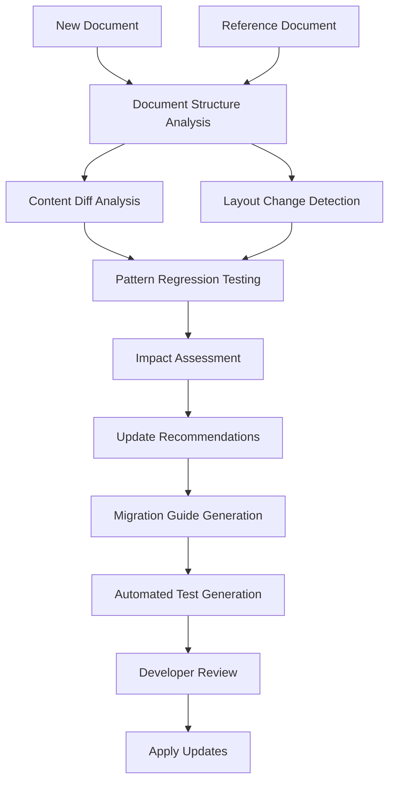

# Benefit Change Detection Tool Design Document

## Overview

The Benefit Change Detection Tool is a developer utility designed to automatically detect changes in vision insurance benefit structures and provide recommendations for updating extractors, pattern libraries, and templates. This tool addresses the challenge of maintaining accuracy when insurance providers modify their benefit documents, terminology, or document formats.

## Problem Statement

Vision insurance providers frequently update their benefit structures, document formats, and terminology. These changes can cause:

1. **Silent extraction failures** - Patterns no longer match, resulting in missing or incorrect data
2. **Confidence score degradation** - Extraction quality decreases without obvious failure indicators
3. **Template mismatches** - New benefit structures don't fit existing Pydantic models
4. **Manual maintenance overhead** - Developers must manually identify and fix extraction issues
5. **Production data quality issues** - Incorrect extractions may not be caught until deployed

## Solution Architecture

### Core Components

```
benefit_change_detection_tool/
├── analyzers/
│   ├── document_structure_analyzer.py    # PDF structure and layout analysis
│   ├── content_diff_analyzer.py          # Text content and terminology changes
│   ├── pattern_regression_analyzer.py    # Pattern matching effectiveness testing
│   └── template_schema_analyzer.py       # JSON schema evolution analysis
├── detectors/
│   ├── layout_change_detector.py         # Document layout modifications
│   ├── terminology_change_detector.py    # Vocabulary and term evolution
│   ├── benefit_structure_detector.py     # New/modified benefit categories
│   └── pricing_change_detector.py        # Cost structure modifications
├── generators/
│   ├── pattern_update_generator.py       # Suggests pattern library updates
│   ├── template_migration_generator.py   # Pydantic model evolution suggestions
│   └── test_case_generator.py            # Automated test generation for changes
├── reporters/
│   ├── change_impact_reporter.py         # Impact assessment and priority scoring
│   ├── migration_guide_generator.py      # Step-by-step update instructions
│   └── regression_report_generator.py    # Extraction quality regression analysis
├── integrations/
│   ├── pattern_library_integration.py    # Integration with existing pattern system
│   ├── extractor_integration.py          # Integration with provider extractors
│   └── ci_cd_integration.py              # Continuous integration hooks
└── cli/
    ├── compare_command.py                 # CLI interface for document comparison
    ├── analyze_command.py                 # Analysis and reporting commands
    └── update_command.py                  # Guided update application
```

### Workflow Architecture



## Functional Requirements

### FR1: Document Analysis and Comparison

**FR1.1: Multi-Format Document Support**
- Support PDF documents from all vision insurance providers
- Handle dual-document scenarios (VSP Patient Record + Lens Enhancement)
- Extract text content with coordinate information for layout analysis
- Preserve document metadata and structure information

**FR1.2: Structural Analysis**
- Identify document sections, headers, and organizational structure
- Detect table layouts and coordinate-based positioning
- Map document elements to extraction targets
- Generate structural fingerprints for comparison

**FR1.3: Content Analysis**
- Extract and normalize terminology used throughout documents
- Identify benefit categories, cost structures, and eligibility criteria
- Parse numerical values, dates, and structured data elements
- Generate content summaries and key term dictionaries

### FR2: Change Detection

**FR2.1: Layout Change Detection**
- Compare document layouts between versions using coordinate analysis
- Detect section additions, removals, and relocations
- Identify table structure modifications
- Flag significant formatting changes that could affect extraction

**FR2.2: Content Change Detection**
- Identify terminology additions, modifications, and removals
- Detect new benefit categories or subcategories
- Flag cost structure changes (new pricing tiers, modified allowances)
- Identify eligibility criteria modifications

**FR2.3: Pattern Impact Analysis**
- Test existing regex patterns against new document structures
- Measure pattern matching success rates and confidence scores
- Identify which specific patterns are affected by changes
- Generate failure analysis reports with specific pattern recommendations

### FR3: Update Recommendation Engine

**FR3.1: Pattern Library Updates**
- Suggest new regex patterns for modified content
- Recommend pattern confidence score adjustments
- Propose fallback pattern additions for robustness
- Generate pattern variations for terminology changes

**FR3.2: Template Evolution**
- Analyze extracted JSON schema changes
- Suggest Pydantic model field additions/modifications
- Identify breaking changes in data structure
- Propose backward-compatible migration strategies

**FR3.3: Extractor Modifications**
- Recommend specific extractor method updates
- Suggest new extraction logic for changed document sections
- Propose confidence scoring adjustments
- Generate integration testing recommendations

### FR4: Reporting and Documentation

**FR4.1: Impact Assessment Reports**
- Prioritize changes by potential impact on extraction accuracy
- Quantify regression risk for each detected change
- Provide confidence metrics for recommendations
- Generate executive summaries for non-technical stakeholders

**FR4.2: Migration Guides**
- Step-by-step instructions for implementing recommended changes
- Code diff previews for pattern and template updates
- Testing recommendations and validation steps
- Rollback procedures for problematic updates

**FR4.3: Regression Analysis**
- Track extraction quality metrics over time
- Compare before/after performance for implemented changes
- Generate confidence score trend analysis
- Provide extraction accuracy benchmarks

## Technical Architecture

### Core Engine Design

```python
class BenefitChangeDetector:
    """Main orchestrator for benefit change detection."""
    
    def __init__(self, provider: str, config: DetectionConfig):
        self.provider = provider
        self.config = config
        self.analyzers = self._initialize_analyzers()
        self.detectors = self._initialize_detectors()
        self.generators = self._initialize_generators()
    
    async def analyze_documents(
        self, 
        reference_docs: List[DocumentPath], 
        new_docs: List[DocumentPath]
    ) -> ChangeAnalysisReport:
        """Perform comprehensive change analysis."""
        pass
    
    async def generate_recommendations(
        self, 
        analysis_report: ChangeAnalysisReport
    ) -> UpdateRecommendations:
        """Generate specific update recommendations."""
        pass
```

### Integration Points

**Pattern Library Integration**
- Leverage existing `PatternManager` and confidence scoring
- Extend pattern base classes with change detection metadata
- Integrate with provider-specific pattern hierarchies

**Extractor Integration**
- Hook into existing extractor inheritance hierarchy
- Utilize current document classification and processing pipelines
- Maintain compatibility with dual-document processing (VSP)

**Template System Integration**
- Work with existing Pydantic template definitions
- Support template inheritance patterns (e.g., VersantUnifiedTemplate)
- Maintain backward compatibility with existing API contracts

### Data Models

```python
class ChangeDetectionResult(BaseModel):
    """Results from change detection analysis."""
    change_type: ChangeType
    severity: ChangeSeverity
    confidence: float
    affected_components: List[str]
    description: str
    recommendations: List[UpdateRecommendation]

class UpdateRecommendation(BaseModel):
    """Specific recommendation for addressing a detected change."""
    component_type: ComponentType  # Pattern, Template, Extractor
    component_path: str
    change_description: str
    recommended_action: str
    code_diff: Optional[str]
    risk_level: RiskLevel
    testing_requirements: List[str]

class ChangeAnalysisReport(BaseModel):
    """Comprehensive analysis report."""
    provider: str
    analysis_date: datetime
    document_comparison: DocumentComparisonSummary
    detected_changes: List[ChangeDetectionResult]
    overall_impact_score: float
    recommended_actions: List[UpdateRecommendation]
    migration_priority: MigrationPriority
```

## Implementation Strategy

### Phase 1: Foundation and Core Analysis
- Implement document structure analyzer with coordinate-based comparison
- Build basic content diff analyzer for terminology changes
- Create pattern regression testing framework
- Develop core reporting infrastructure

### Phase 2: Advanced Detection and Recommendations
- Implement sophisticated change detection algorithms
- Build update recommendation engine with code generation
- Create integration with existing pattern library system
- Develop automated test case generation

### Phase 3: Developer Experience and Automation
- Build CLI interface with guided workflows
- Implement CI/CD integration hooks
- Create web-based dashboard for change monitoring
- Add automated notification systems for detected changes

### Phase 4: Production Integration and Monitoring
- Implement continuous monitoring of document changes
- Build production deployment integration
- Create rollback and recovery mechanisms
- Establish change detection performance metrics

## Usage Scenarios

### Scenario 1: New Document Version Detected

```bash
# Compare new VSP document with reference
benefit-detector compare \
    --provider vsp \
    --reference ./samples/vsp_patient_record_v1.pdf \
    --new ./samples/vsp_patient_record_v2.pdf \
    --output ./analysis/vsp_change_report.json

# Generate update recommendations
benefit-detector analyze \
    --report ./analysis/vsp_change_report.json \
    --generate-migrations \
    --output ./migrations/vsp_updates/
```

### Scenario 2: Continuous Integration Integration

```yaml
# GitHub Actions workflow
name: Benefit Change Detection
on:
  schedule:
    - cron: '0 6 * * 1'  # Weekly on Monday
  
jobs:
  detect-changes:
    runs-on: ubuntu-latest
    steps:
      - uses: actions/checkout@v3
      - name: Run Change Detection
        run: |
          benefit-detector monitor \
            --providers all \
            --baseline ./baselines/ \
            --alert-threshold 0.7 \
            --create-pr-on-changes
```

### Scenario 3: Developer Workflow

```bash
# Developer investigating extraction quality degradation
benefit-detector regression-analysis \
    --provider eyemed \
    --timerange "2024-01-01,2024-03-01" \
    --confidence-threshold 0.8 \
    --generate-fixes

# Apply recommended fixes with review
benefit-detector apply-updates \
    --migration-path ./migrations/eyemed_fixes/ \
    --dry-run \
    --show-diff
```

## Risk Mitigation

### Technical Risks

**R1: False Positive Change Detection**
- Mitigation: Implement confidence thresholds and manual review workflows
- Validation: Extensive testing with historical document versions
- Monitoring: Track false positive rates and adjust detection sensitivity

**R2: Incomplete Change Coverage**
- Mitigation: Multi-layered detection approach with different analysis methods
- Validation: Comprehensive test coverage across all provider document types
- Monitoring: Track extraction accuracy post-deployment

**R3: Integration Complexity**
- Mitigation: Modular design with clear integration points
- Validation: Extensive integration testing with existing codebase
- Monitoring: Performance impact assessment on existing extraction pipelines

### Operational Risks

**R4: Developer Adoption Resistance**
- Mitigation: Intuitive CLI and clear documentation
- Validation: Developer feedback during beta testing
- Monitoring: Usage metrics and developer satisfaction surveys

**R5: Production Disruption**
- Mitigation: Staged rollout with rollback procedures
- Validation: Shadow mode testing in production environment
- Monitoring: Real-time extraction quality metrics

## Success Metrics

### Quantitative Metrics
- **Change Detection Accuracy**: >95% detection rate for significant changes
- **False Positive Rate**: <10% for change recommendations
- **Extraction Quality Improvement**: >20% reduction in confidence score degradation
- **Development Velocity**: >50% reduction in manual update time
- **Production Issue Reduction**: >80% reduction in extraction-related production issues

### Qualitative Metrics
- Developer satisfaction with tool usability and effectiveness
- Reduced manual effort required for extractor maintenance
- Improved confidence in production extraction accuracy
- Better documentation and change tracking processes

## Future Enhancements

### Machine Learning Integration
- Train models to predict likely change patterns based on historical data
- Implement intelligent pattern generation using document analysis
- Develop automated quality assessment for generated recommendations

### Advanced Analytics
- Build trend analysis for insurance industry benefit changes
- Create predictive models for future document structure evolution
- Implement cross-provider change correlation analysis

### Enhanced Developer Experience
- Web-based visual diff tool for document comparison
- Interactive pattern testing and validation interface
- Real-time extraction quality monitoring dashboard

## Conclusion

The Benefit Change Detection Tool represents a critical capability for maintaining the accuracy and reliability of the Vision Extractor Service as insurance providers evolve their benefit structures. By automating change detection and providing intelligent update recommendations, this tool will significantly reduce maintenance overhead while improving extraction quality and developer productivity.

The modular design ensures compatibility with the existing codebase while providing a foundation for future enhancements and machine learning integration. The phased implementation approach allows for iterative development and validation, minimizing risk while maximizing value delivery.