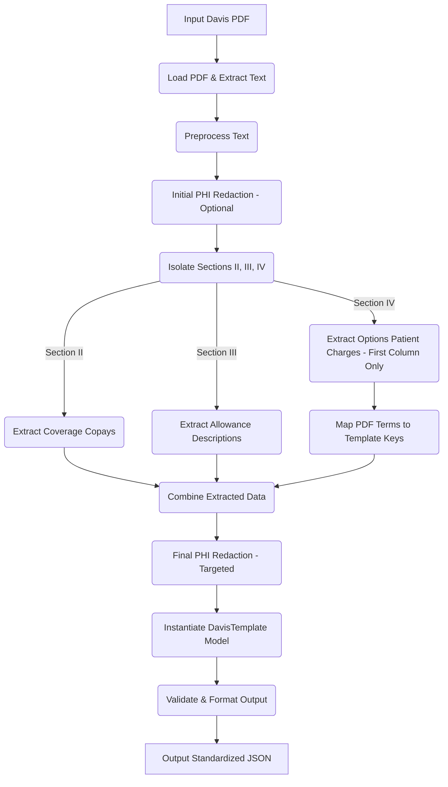

# Davis Vision Benefits Extractor - Design Plan

## 1. Goal Confirmation

The objective is to create a `DavisExtractor` that processes Davis Vision benefit PDFs, extracts patient charges for various services and options (exams, frames, lenses, materials, add-ons), redacts PHI, and outputs this information into a standardized JSON structure based on the provided template (`tests/samples/Davis/davis output template.txt`), ensuring consistency and focusing solely on pricing ("None" if not found).

## 2. Proposed Approach

We will adopt an approach similar to the `SpecteraExtractor`:
*   **Direct PDF Processing:** The extractor will open and read the PDF content directly using the `fitz` (PyMuPDF) library.
*   **Regex-Driven Extraction:** We will rely heavily on regular expressions to identify sections, locate benefit lines, and extract the corresponding "Patient Charge" value (first column in options).
*   **Template-Based Output:** A `DavisTemplate` Pydantic model will define the target JSON structure.
*   **Mapping:** A mapping mechanism (`davis_mapping.py`) will translate PDF terms to standardized template keys.

## 3. Core Components

*   **`app/core/extractors/davis_extractor.py`:** `DavisExtractor` class inheriting from `BaseExtractor`.
*   **`app/core/templates/davis_template.py`:** Pydantic models (`DavisTemplate`, `CoverageInfo`, `AllowanceInfo`, `LensBenefits`, etc.).
*   **`app/config/davis_mapping.py`:** New file for PDF term -> template key mapping.
*   **`app/core/pattern_library/providers/Davis/`:** New directory/files for Davis-specific regex patterns.
*   **`app/core/utils/security.py`:** Leverage for PHI redaction.

## 4. Detailed Extraction Steps

1.  **Preprocessing:** Load PDF (`fitz`), extract text, basic cleaning.
2.  **Initial PHI Redaction (Optional):** Apply basic PHI pattern matching on raw text.
3.  **Section Isolation:** Use regex to find "SECTION II - COVERAGE SECTION", "SECTION III - ALLOWANCE SECTION", "SECTION IV - OPTIONS SECTION".
4.  **Coverage Extraction (Section II):** Use regex to find base copays (Exam, Frame, Spectacle Lenses).
5.  **Allowance Extraction (Section III):** Use regex to find allowance descriptions (Frame, Contact Lens Material). Store as:
    ```json
    "allowances": {
      "frame": { "description": "..." },
      "contact_lens_material": { "description": "..." }
    }
    ```
6.  **Options Extraction (Section IV):**
    *   Iterate through template items.
    *   Look up PDF term(s) via `davis_mapping.py`.
    *   Use regex targeting the PDF term to capture only the *first* value (Patient Charge).
    *   Convert value to number (or 0 for "Included", `None` if not found).
    *   Populate `lens_benefits` dictionary.
7.  **Final PHI Redaction (Targeted):** Ensure designated PHI fields are `[REDACTED]`.
8.  **Output Generation:** Instantiate `DavisTemplate` model, convert to dictionary.

## 5. Workflow Diagram



## 6. Considerations

*   **Patient Charge Focus:** The output structure directly maps keys to the numeric patient charge.
*   **Conditional Pricing:** Handling footnote-based exceptions (e.g., Polycarbonate `***`) is deferred as a future enhancement.

## 7. Versant Health Support

Davis Vision and Superior Vision have been combined under Versant Health. The extractor framework has been extended to support Versant Health documents:

*   **`app/core/extractors/versant_extractor.py`:** `VersantExtractor` class inheriting from `DavisTabularExtractor`.
*   **`app/core/templates/versant_template.py`:** Pydantic model that extends `DavisTemplate`.
*   **Re-use of Davis Infrastructure:** The Versant Health extractor leverages the Davis Vision tabular extractor since it's compatible with the new benefit documents.

### Versant Health Extraction Approach

The Versant Health extraction process:
1. Extends the Davis tabular extraction logic to maintain compatibility
2. Uses the same table parsing techniques from the Davis tabular extractor
3. Returns results using the Versant Health provider name and plan name
4. Handles dual-branding cases where both Versant Health and Davis/Superior names appear in documents
5. Maintains the same output structure as the Davis Vision extractor

This approach maximizes code reuse while ensuring proper identification and handling of Versant Health documents.