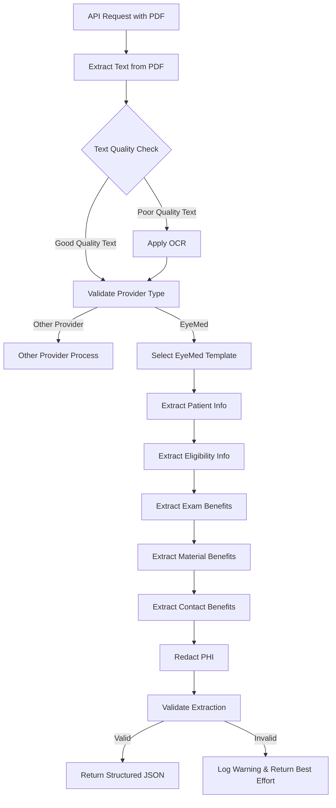

# EyeMed Extraction Workflow

This document outlines the extraction workflow for EyeMed vision insurance documents.

## Overview

The extraction process follows these key steps:

1. **Document Reception**: PDF document is received via API
2. **Document Classification**: System identifies the document as an EyeMed document
3. **Template Selection**: EyeMed-specific template is selected
4. **Text Extraction**: Text is extracted from the PDF, with OCR applied if needed
5. **Data Extraction**: EyeMed-specific extractor extracts structured data
6. **PHI Redaction**: Personally Identifiable Information (PHI) is identified and redacted
7. **Validation**: Extracted data is validated against the EyeMed template schema
8. **Response**: Structured JSON data is returned

## Detailed Workflow



## Component Details

### 1. Document Reception
- PDF document is uploaded via API endpoint `/api/v1/extract`
- Document is temporarily stored and assigned a unique extraction ID

### 2. Document Classification
- Text is extracted from the PDF using PyMuPDF
- OCR is applied to any pages with limited text using Tesseract
- EyeMed patterns are matched using regex patterns in `provider_patterns.py`
- Document is classified as EyeMed with a confidence score

### 3. Template Selection
- `EyeMedTemplate` is selected based on provider classification
- Template defines the structure for the extracted data

### 4. EyeMed-specific Extraction
- `EyeMedExtractor` implements extraction logic specific to EyeMed documents
- Extracts:
  - Patient information (member ID, name, network, group)
  - Eligibility information for exams, frames, lenses, and contacts
  - Vision benefits (exams, frames, lenses, lens options, contact lenses)

### 5. PHI Redaction
- Personal Health Information is identified and redacted
- Includes names, DOB, member IDs, and other identifiers
- Redaction process is implemented in `security.py`

### 6. Validation
- Extracted data is validated against the `EyeMedTemplate` schema
- Validation ensures all required fields are present and correctly formatted
- Implemented in `SchemaValidator`

### 7. Response
- Structured JSON is returned with:
  - Provider information ("EyeMed")
  - Extraction ID
  - Structured data following the template
  - Confidence scores
  - Processing time metadata

## Example Output

```json
{
  "provider": "eyemed",
  "extraction_id": "550e8400-e29b-41d4-a716-446655440000",
  "data": {
    "provider": "EyeMed",
    "patient_info": {
      "member_id": "ABC123456",
      "member_name": "John Doe",
      "network": "Insight",
      "group": "Group123"
    },
    "eligibility_info": {
      "exam": {
        "is_eligible": true,
        "eligible_as_of": "01/01/2023",
        "frequency": "Once every 12 months"
      },
      "frame": {
        "is_eligible": true,
        "eligible_as_of": "01/01/2023",
        "frequency": "Once every 24 months"
      }
    },
    "vision_benefits": {
      "exam_services": {
        "exam": {
          "provider_name": "EyeMed",
          "cost_type": "copay",
          "cost_value": "$10",
          "cost_details": "For routine eye exam"
        }
      },
      "frame": {
        "provider_name": "EyeMed",
        "cost_type": "allowance",
        "allowance": "$150",
        "discount_percentage": "20%"
      }
    }
  },
  "confidence": 0.92,
  "processing_time": 1.25
}
```

## Error Handling

- Provider type is user-defined and required; the system validates the provider type from the user's selection
- If text extraction fails, system attempts OCR as a fallback
- If validation fails, system logs warnings and returns best-effort data
- All exceptions are caught and proper error responses returned

## PHI Compliance

- All PHI data is handled in compliance with HIPAA regulations
- Only the minimum necessary information is extracted and returned
- PHI is redacted in logs and any debug information 